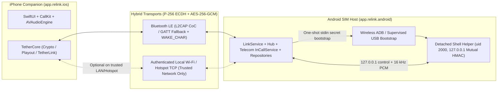

# Architecture Overview

> [!NOTE]
> ReLink is archived at `1.3.0-beta.10`. For the detailed subsystem guide, see [`docs/ARCHITECTURE.md`](docs/ARCHITECTURE.md); for the 19-module boundary rules verified by `tools/check-architecture.py`, see [`docs/MODULE_ARCHITECTURE.md`](docs/MODULE_ARCHITECTURE.md); for open failure analyses, see [`docs/research/README.md`](docs/research/README.md).

## System Topology

## Key Modules

| Module / Directory | Language / Target | Responsibility |
| --- | --- | --- |
| `android/core` | Kotlin / JVM 17 | Pure-JVM protocol contract (`Proto`, `Crypto`, `Records`, `T`, `OpusCodec`), free of Android SDK imports |
| `android/app` | Kotlin / Android 8+ | BLE peripheral, local Wi-Fi link, foreground service, Telecom dialer, SMS/contacts/call-log repos, Material 3 host UI |
| `android/helper` | Kotlin / Android `uid 2000` | Headless shell process (`app_process`) for call-audio interception/injection and privileged network switches |
| `android/client` | Kotlin / Android 10+ | Standalone second-Android BLE companion client sharing wire code only via `:core` |
| `ios/TetherCore` | Swift 5.9 + C (`libopus 1.5.2`) | Portable iOS/macOS/Linux core library + `COpus` wrapper; UI- and CallKit-free |
| `ios/Tether` | SwiftUI / iOS 16+ | Companion UI, CallKit controller, `AVAudioEngine` call audio graph, CoreBluetooth central link |
| `protocol/` | Spec + JSON vectors/fixtures | Wire v1 contract ([`protocol/PROTOCOL.md`](protocol/PROTOCOL.md)), `compatibility.json`, and deterministic fixtures |
| `tools/` | Python / Shell / PowerShell | Protocol, architecture, docs-link, UI guardrail, and privacy verification scripts |
