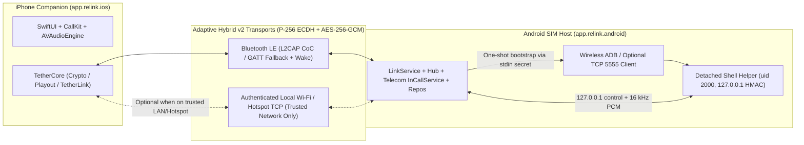

<p align="center"></p>

<h1 align="center">ReLink</h1>

<p align="center"><strong>Two phones. One connection.</strong><br>
An independent MIT derivative of <a href="https://github.com/amirwmr/tether">Tether</a> bringing an Android SIM phone's calls, SMS, contacts and call history to an iPhone — end-to-end encrypted, serverless, with adaptive Bluetooth LE and trusted local Wi-Fi transport.<br>
Current development target: <code>1.3.0-beta.8</code> · Wire protocol: <code>v1</code> · IDs: <code>app.relink.android</code> / <code>app.relink.ios</code></p>

<p align="center">
  <a href="docs/RELINK_INSTALL.md">Install &amp; Build</a> ·
  <a href="docs/COMPATIBILITY.md">Compatibility</a> ·
  <a href="docs/ARCHITECTURE.md">Architecture</a> ·
  <a href="docs/ROADMAP.md">Roadmap</a> ·
  <a href="SECURITY.md">Security</a> ·
  <a href="docs/fa/RELINK.md">راهنمای فارسی</a>
</p>

---

## Overview

Keep the Android phone carrying your SIM cards in a pocket or bag. **ReLink** lets your paired iPhone (or second Android client) handle cellular calls via CallKit, synchronize and send SMS/OTP messages, browse and edit contacts, toggle Android connectivity switches, and carry call audio without relying on any cloud service or user account.

ReLink builds on upstream Tether (`1.2.4` + integrated `1.2.5` audio/CallKit fixes) while adding:

- **Adaptive Hybrid v2 transport:** Separates logical ReLink sessions from physical transports across **Automatic** (default), **Wi-Fi Preferred**, and **Bluetooth Only** modes, keeping Bluetooth LE (`L2CAP` CoC with GATT fallback) always available for discovery, pairing, background wake and fallback.
- **ReLink A4 identity & Material 3 host UI:** Flat Premium visual system (`#101216` / `#70DDC4` / `#F4F5F7`) with English and RTL Persian localization.
- **Decoupled ADB & Shell Helper diagnostics:** Explicitly separates live Helper reachability (`127.0.0.1` mutual HMAC) from transient Wireless ADB (`adbd`) availability and one-shot `TCP 5555` checks.

---

## Verified Status and Hardware Evidence

ReLink distinguishes **observed physical hardware results** from **offline automated verification** and **pending field retests**:

| Capability | Target Hardware (`Galaxy A71 SM-A715F, Android 13` + `iPhone 14 Pro Max`) | Offline / Engineering Verification (`1.3.0-beta.8`) |
| --- | --- | --- |
| **APK install & Play Protect** | Beta 6 installed after scanning. The owner reported that Beta 7 was blocked. Beta 8 acceptance is unverified. | Android release backup exclusions are configured. |
| **iOS install & visual UI** | **Observed (Beta 6):** Sideloading, A4 icons and iOS UI approved. | Xcode/macOS CI defined; **blocked on Windows** (requires macOS + Xcode). |
| **QR / manual pairing & SMS sync** | **Observed (Beta 6 & Beta 7):** Pairing and SMS synchronization succeeded. | Core crypto vectors, handshake & sync contracts tested offline. |
| **Outgoing cellular call initiation** | **Observed (Beta 6):** Outgoing carrier call dial & Telecom state handling succeeded. | Android host & client CallTracker unit tests pass offline. |
| **Wireless ADB & Audio Helper** | **Degraded (Beta 6 UI)** although read-only inspection confirmed Helper alive (`intercept`) even after Wi-Fi turned off. Beta 8 fixes pending A71 retest. | Route-bound `shellOnRoute`, shell probe (`printf R`), loopback HMAC, stdin/temp-file token, `AdbAddressPolicy` local-host checks unit-tested. |
| **Bidirectional SIM call audio & AirPods** | **Pending / Unverified:** Beta 6 failed on BLE 2.4 GHz hotspot contention and AirPods route race (`uplinkSpeechFrames=0`). Beta 7/8 audio + upstream `1.2.5` fixes require live carrier SIM retest. | Upstream `1.2.5` Qualcomm mixer/mic-mute safeguards, CallKit recovery source patch and `CallAudioReport` tests verified locally (Android JVM + script checks). |
| **Adaptive Hybrid Wi-Fi / BLE failover** | **Pending:** Galaxy A71 hotspot moved to 5 GHz (`Beta 7`); live multi-network failover & Bluetooth-only stress test pending. | Transport policy, sync reset on transport switch and unit tests pass offline. |

> [!IMPORTANT]
> Simulated loopback tests and offline unit suites **do not prove audible two-way cellular call audio** on physical devices. Upstream Tether results (such as Galaxy A54 or Galaxy A73 reports) apply only to upstream software on those specific models and firmwares.

---

## Architecture



## Repository Layout

| Directory | Contents |
| --- | --- |
| `android/app` | Android host application (`app.relink.android`): BLE peripheral, local Wi-Fi link, foreground service, Telecom dialer, SMS/contacts/calls repositories, Wireless ADB & Helper bridge, Material 3 UI |
| `android/helper` | Privileged shell helper (`uid 2000`): call-audio interception/injection, Qualcomm mixer & mic-mute safeguards, redirect guard, network state switches |
| `android/core` | Pure Kotlin/JVM wire SDK (`core`): handshake, AES-256-GCM records, framing, message definitions, G.711 and Concentus Opus codecs |
| `android/core-android` | Android platform `MediaCodec` Opus wrapper (`core-android`) |
| `android/client` | Second-Android client application (`app.tether.client`) |
| `ios/Tether` | SwiftUI iPhone / iPad app (`app.relink.ios`), CallKit controller, audio routing |
| `ios/TetherCore` | Swift SDK (`TetherCore`) + vendored `COpus` (`libopus 1.5.2`) |
| `protocol/` | Wire contract ([PROTOCOL.md](protocol/PROTOCOL.md)), `compatibility.json`, shared `vectors.json` & fixtures |
| `tools/` | Offline contract, docs-link, theme guardrail, privacy scan and AltStore scripts |
| `docs/` | English documentation & Persian guides ([docs/fa/RELINK.md](docs/fa/RELINK.md)) |

---

## Setup and Building from Source

Public prebuilt release binaries are not currently published on `heat-core/relink`. Build both apps from the same revision so Android and iOS share matching `VERSION` (`1.3.0-beta.8`) and build numbers (`1030008`).

### Prerequisites

- **Android build:** JDK 17, Android SDK platform 36 & Build Tools `36.0.0`.
- **iOS build:** macOS with Xcode 16+ (tested in upstream/CI configs up to Xcode 26.6), `XcodeGen`, and an Apple ID (free 7-day sideloading or paid Developer account) for owner signing.

### 1. Verify Protocol, Privacy & Build Android (Local / Offline)

```bash
python tools/check-protocol.py
python tools/check-docs-links.py
python tools/check-guardrails.py
bash tools/check-private.sh --all

cd android
./gradlew --console=plain :core:test :app:testDebugUnitTest :helper:testDebugUnitTest :client:testDebugUnitTest :app:lintRelease :app:assembleRelease
```

Signing keys are never committed to Git. Sign your local APK with your own permanent keystore (`docs/RELEASING.md`) and verify with `apksigner verify --verbose --print-certs`. Keep Google Play Protect enabled on the target phone.

### 2. Build Unsigned iPhone App (macOS)

```bash
cd ios && xcodegen generate
xcodebuild -project Tether.xcodeproj -scheme Tether -onlyUsePackageVersionsFromResolvedFile \
  -configuration Release -destination 'generic/platform=iOS' CODE_SIGNING_ALLOWED=NO build
```

Then sign with your own Apple account via Xcode (`docs/BUILD.md`) or package an unsigned IPA for SideStore/AltStore/Sideloadly (`docs/RELINK_INSTALL.md`).

### 3. Pair & Initialize Call Audio

1. Enable Bluetooth on both phones and pair via QR code or manual code on the Android host. Bluetooth Only mode remains independent without Wi-Fi or hotspot.
2. Enable iOS **Local Network** permission only if using **Automatic** or **Wi-Fi Preferred** over a trusted LAN or the Android hotspot (5 GHz recommended where supported).
3. Use Android-local call audio for this development candidate unless an authenticated compatible Audio Helper is already running. New in-app Helper startup is paused.

---

## Known Limitations and Security Notes

- **Development security gates:** New in-app Audio Helper startup and Share VPN are paused. Existing authenticated Helper reattachment remains available for follow-up testing. [Security policy](SECURITY.md)
- **Google Play Protect:** Only Beta 6 was inspected and approved on the reference Galaxy A71. Beta 7/8 release APKs require owner-verified signing and Play Protect review before field testing.
- **Hosted CI Status:** Hardened workflow templates (`.github/workflows/`) pin all Actions to full commit SHAs with least-privilege permissions, and GitHub Actions remain disabled in repository settings until explicitly enabled by the maintainer.
- **Android 8–10 Call Audio & MMS/RCS:** Call audio requires Android 11+ (best on Android 13+ with vendor HAL support). MMS, RCS, group messaging and video calls are out of scope.
- **Privacy in Issue Reports:** Never post real phone numbers, contacts, SMS/OTP messages, device serials, IP/MAC addresses or unredacted logs ([SUPPORT.md](SUPPORT.md)).

---

## Documentation Index

- **Getting started:** [ReLink Install Guide](docs/RELINK_INSTALL.md) · [Build from Source](docs/BUILD.md) · [First-Time Setup](docs/SETUP.md) · [Usage](docs/USAGE.md) · [FAQ](docs/FAQ.md)
- **Devices & debugging:** [Compatibility Matrix](docs/COMPATIBILITY.md) · [Android Version Features](docs/devices/android-versions.md) · [Troubleshooting](docs/TROUBLESHOOTING.md) · [Testing Guide](docs/TESTING.md)
- **Architecture & SDKs:** [Architecture](docs/ARCHITECTURE.md) · [Wire Protocol](protocol/PROTOCOL.md) · [Swift SDK](docs/SDK-swift.md) · [Kotlin SDK](docs/SDK-kotlin.md) · [Extending](docs/EXTENDING.md)
- **Project governance:** [Roadmap](docs/ROADMAP.md) · [Contributing](CONTRIBUTING.md) · [Security Policy](SECURITY.md) · [Support](SUPPORT.md) · [Changelog](CHANGELOG.md) · [Provenance](PROVENANCE.md)
- **فارسی:** [راهنمای جامع فارسی ReLink](docs/fa/RELINK.md) · [پرسش‌های رایج](docs/fa/faq.md)

## License and Attribution

ReLink is licensed under the [MIT License](LICENSE), preserving upstream copyright from [Tether](https://github.com/amirwmr/tether). Third-party libraries retain their respective licenses; see [NOTICE](NOTICE), [THIRD_PARTY_NOTICES.md](THIRD_PARTY_NOTICES.md), [PROVENANCE.md](PROVENANCE.md) and [BRAND_USAGE.md](BRAND_USAGE.md).
