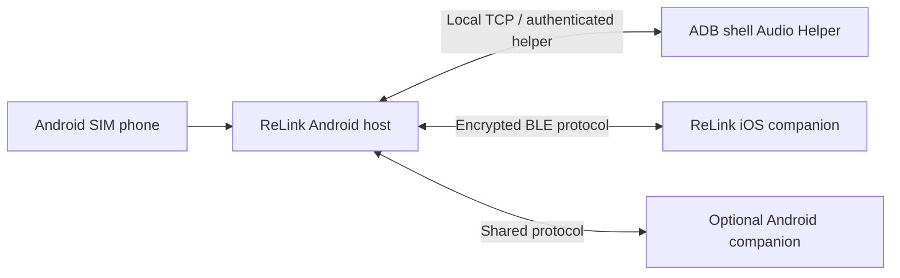

<p align="center">
  
</p>
<h1 align="center">ReLink</h1>
<p align="center"><em>Two phones. One connection.</em></p>
<p align="center">A personal Android-to-iOS phone bridge for calls, SMS, one-time codes, contacts and call history.</p>
<p align="center">
  
  
  <a href="LICENSE"></a>
  
  
  
</p>
<p align="center"><a href="#download">Download</a> · <a href="#setup">Setup</a> · <a href="#development">Development</a> · <a href="#compatibility">Compatibility</a> · <a href="#فارسی">فارسی</a></p>

> **Development preview:** ReLink is a private, non-commercial project derived from [Tether](https://github.com/amirwmr/tether). Beta 6 (`v1.3.0-beta.6`) has passed build, signature, and automated test checks; physical installation, live pairing, and bidirectional cellular call audio on target phones still await hardware testing.

## Overview

Keep your SIM cards in an Android host and use an iPhone as your everyday companion. ReLink is designed to relay phone functions over a direct Bluetooth LE link without requiring a hosted relay server or a ReLink account. The Android host manages the SIM and telephony; the iOS companion provides a native interface using CallKit and SwiftUI.

## Features

The following are implemented or inherited capabilities, not a guarantee of device compatibility:

- Incoming and outgoing calls, CallKit call controls, and device-dependent two-way audio bridging.
- SMS conversations, notifications, and convenient access to one-time codes (OTP).
- Contacts, favourites, call history, and dialling.
- QR and manual pairing (`tether1:` / `tether://` and `relink://`), connection status, and reconnection.
- Independent capture and injection diagnostics, Audio Helper startup reporting, and local audio fallback.
- English and Persian interfaces, including right-to-left layouts and light/dark themes.
- An optional Android companion (`android/client`, "ReLink Client") exists in the source tree; its physical-device behaviour and availability as a Beta 6 release asset are not confirmed.

Some inherited network tools and SMS write operations depend on Android permissions and device support. Automatic system permission grants were removed in Beta 4.

## Download

Get the verified Beta 6 release assets from ReLink 1.3.0 Beta 6 (or browse the ReLink releases page). Do not mix builds from earlier Tether releases.

| Asset | Purpose & Status |
| --- | --- |
| `ReLink-Android-1.3.0-Beta6.apk` | Signed Android host APK (`app.relink.android`, V2+V3 signed) for the SIM phone |
| `ReLink-iOS-1.3.0-Beta6.ipa` | Unsigned iOS companion (`app.relink.ios`); requires re-signing via SideStore / iLoader with your Apple account |
| `SHA256SUMS.txt` | Verified SHA-256 checksums for both binaries |
| Release notes, installation guide, test report, and known issues | Attached to the Beta 6 release for provenance and testing instructions |

The iOS IPA is built using GitHub Actions on macOS (`xcodebuild` Release `generic/platform=iOS`); a local Mac is not required. Because the IPA is unsigned (`TETHER_COMM_NOTIFICATIONS=NO`, no paid entitlements), **SideStore / iLoader re-signing is required** before installation. Free Apple account signatures generally require renewal every seven days.

The Android APK is signed with the owner's permanent release keystore (certificate SHA-256 `16fa11bc99a96625b4cfff190404cf4d7ebee59db2a437c89ff2f774eeb2bd6d`). Keep Google Play Protect enabled; if it flags an installation warning, stop and investigate rather than bypassing it.

## Setup

1. Install the verified signed `ReLink-Android-1.3.0-Beta6.apk` on your SIM-holding Android phone and re-sign/install `ReLink-iOS-1.3.0-Beta6.ipa` on your iPhone using SideStore or iLoader.
2. Open ReLink on both phones, enable Bluetooth, and grant the requested permissions. Set ReLink as the Android default phone app when asked.
3. Pair using a fresh QR code or manual pairing code entry. Keep any older Tether Enhanced host app inactive or uninstalled before pairing.
4. For call audio bridging (`Android 11+`), connect the Android host to a trusted Wi-Fi network and complete one-time Wireless Debugging pairing for ReLink. (A USB ADB connection from a computer does not establish the app's own local ADB session.)
5. Check the live ADB connection in Setup, start Audio Helper, confirm Ready status, and run capture/injection self-tests.
6. Test incoming and outgoing calls with a consenting participant, verifying audio in both directions. Export sanitized diagnostics if a step fails.

Beta 6 uses new application identifiers (`app.relink.android` and `app.relink.ios`), so it does not migrate saved pairing keys or data from earlier Tether builds. Do not delete older apps or data until the new setup is validated.

## Architecture



The active call-audio backend uses local TCP. Binder IPC and separate pipes have been explored with synthetic probes in development; they are not an active real-call transport in this release. The shared wire protocol (`wire 1`) uses authenticated P-256 key agreement and AES-GCM encryption. Android Kotlin (`android/core`) and Swift (`ios/TetherCore`) implementations are verified against shared test vectors and checked for drift in CI.

## Compatibility

| Target | Status |
| --- | --- |
| Samsung Galaxy A71 (`SM-A715F`), Android 13 / One UI 5.1 | Primary host target; Beta 6 hardware validation pending |
| iPhone 14 Pro Max | Primary companion target; Beta 6 SideStore installation and live pairing pending |
| iOS 16 or later | Build deployment target (`MinimumOSVersion`), not a universal device guarantee |
| Other Android phones / versions (`Android 8+` host, `Android 11+` call audio) | Inherited platform support varies; not independently validated for ReLink |
| iPad / second Android companion | Not validated on physical devices for Beta 6 |
| Legacy Tether clients | Not a compatibility target; use matched ReLink builds |

Android call capture and injection depend on OS and vendor restrictions. An iPhone cannot serve as the SIM host for its native cellular calls and SMS. MMS, RCS, and video calls are outside current scope.

## Development status

**Beta 6 — `1.3.0-beta.6`** (build `1030006`) · Shared source build commit `private archive` (tag `v1.3.0-beta.6`).

| Validation | Status / Result |
| --- | --- |
| Android automated tests (`:core`, `:app`, `:helper`, `:client`) | 396 passed, 0 failed, 0 skipped (local & CI) |
| Swift Core tests (`ios/TetherCore`) | 225 passed (190 XCTest + 35 Swift Testing), 0 failed |
| iOS Simulator tests (`TetherTests`) | 82 passed, 0 failed |
| Android release build, `lintRelease`, `zipalign`, `apksigner` V2+V3 | Passed & signed (`16fa11bc...`) |
| Full Xcode release build & `check-ios-artifact.py` | Passed (unsigned SideStore/iLoader IPA) |
| Physical installation & Google Play Protect check | Pending hardware validation |
| SideStore / iLoader re-signing & iPhone install | Pending hardware validation |
| Live BLE pairing / Wireless ADB / Audio Helper `HELLO` | Pending hardware validation |
| Real two-way cellular call audio | Pending hardware validation |

Build workflow: Beta 6 release build · Test workflow: CI run. Verify downloaded files against SHA256SUMS.txt.

## Development

```bash
git clone https://github.com/heat-core/relink.git
cd relink
```

Access to the private repository is required. Android uses JDK 17, Gradle, and the Android SDK (`compileSdk` / `targetSdk` 36). On Windows, from the `android` directory:

```powershell
.\gradlew.bat :app:assembleRelease
```

Release signing uses the owner's existing local PKCS#12 keystore outside Git. Never commit keys, passwords, or local signing files. See [build documentation](docs/BUILD.md) for local configuration. Use the repository's GitHub Actions macOS workflow (`Beta release builds`) for iOS, or build the Xcode project on a Mac. Always build both binaries from the same source commit and verify `tools/check-protocol.py` before publishing.

| Component | Location |
| --- | --- |
| Android host | `android/app` |
| Android companion | `android/client` |
| Android shared core & Audio Helper | `android/core`, `android/helper` |
| iOS project & Swift Core package | `ios/`, `ios/TetherCore` |
| Protocol specification & SDK guides | [protocol/PROTOCOL.md](protocol/PROTOCOL.md), [Swift SDK](docs/SDK-swift.md), [Kotlin SDK](docs/SDK-kotlin.md) |
| Brand assets (`A4` SVG masters) | `docs/images/logo.svg`, `docs/images/brand/` |

Application identifiers: `app.relink.android` and `app.relink.ios`. Internal package/target names (`app.tether.*`, `TetherCore`, `Tether.xcodeproj`) and BLE/wire UUIDs are intentionally kept stable for protocol compatibility.

## Documentation

- [Installation](docs/INSTALL.md) · [Setup](docs/SETUP.md) · [Usage](docs/USAGE.md) · [FAQ](docs/FAQ.md)
- [Troubleshooting](docs/TROUBLESHOOTING.md) · [Architecture](docs/ARCHITECTURE.md) · [Testing](docs/TESTING.md)
- [Android Client](docs/ANDROID-CLIENT.md) · [Swift SDK](docs/SDK-swift.md) · [Kotlin SDK](docs/SDK-kotlin.md) · [Extending](docs/EXTENDING.md)
- [Build](docs/BUILD.md) · [Releasing](docs/RELEASING.md) · [Roadmap](docs/ROADMAP.md) · [Changelog](CHANGELOG.md)
- [Security](SECURITY.md) · [License](LICENSE) · [Third-Party Notices](NOTICE)

Some inherited documents under `docs/` still reference the upstream project name or older instructions; prefer `README.md`, `CHANGELOG.md`, and the Beta 6 release notes for current ReLink installation and signing details.

## Security and privacy

ReLink handles sensitive call, message, and contact data using direct authenticated and encrypted BLE communication (`P-256` + `AES-GCM`). The Android Audio Helper requires elevated shell privileges via user-authorized Wireless Debugging ADB; security review, including ADB TLS trust, is ongoing. No claim of a completed third-party security audit or universal device compatibility is made. Use only your own authorized devices and SIM cards, review problem reports before sharing, and follow applicable laws with participant consent when testing live calls.

## فارسی

<div dir="rtl" lang="fa">

**ReLink** (*دو گوشی. یک اتصال.*) پروژه‌ای شخصی و غیرتجاری برای اتصال گوشی اندرویدی سیم‌کارت‌دار به آیفون است تا تماس‌ها، پیامک‌ها، کدهای یک‌بارمصرف، مخاطبین و سابقه تماس از طریق بلوتوث رمزنگاری‌شده روی آیفون در دسترس باشند. نسخه بتا ۶ برای اندروید (`app.relink.android`، امضاشده با کلید دائمی) و آیفون (`app.relink.ios`، فایل `IPA` بدون امضا نیازمند امضای مجدد با `SideStore` یا `iLoader`) روی سرورهای `GitHub Actions` ساخته و راستی‌آزمایی شده است، اما نصب فیزیکی، جفت‌سازی زنده، راه‌اندازی موتور صوتی و تماس واقعی روی `Galaxy A71` و `iPhone 14 Pro Max` هنوز نیازمند آزمایش سخت‌افزاری است. همیشه `Google Play Protect` را روشن نگه دارید.

صفحه انتشار بتا ۶ · [راهنمای فارسی (به‌ارث‌رسیده از پروژه اصلی)](docs/fa/README.md)

</div>

## License and attribution

ReLink is an independent personal derivative of [Tether by amirwmr](https://github.com/amirwmr/tether), not an official upstream release. Original copyright notices and the MIT License remain intact. See [LICENSE](LICENSE) and [NOTICE](NOTICE) for licensing and third-party attribution. ReLink branding does not imply ownership or endorsement of the original project or its dependencies.
